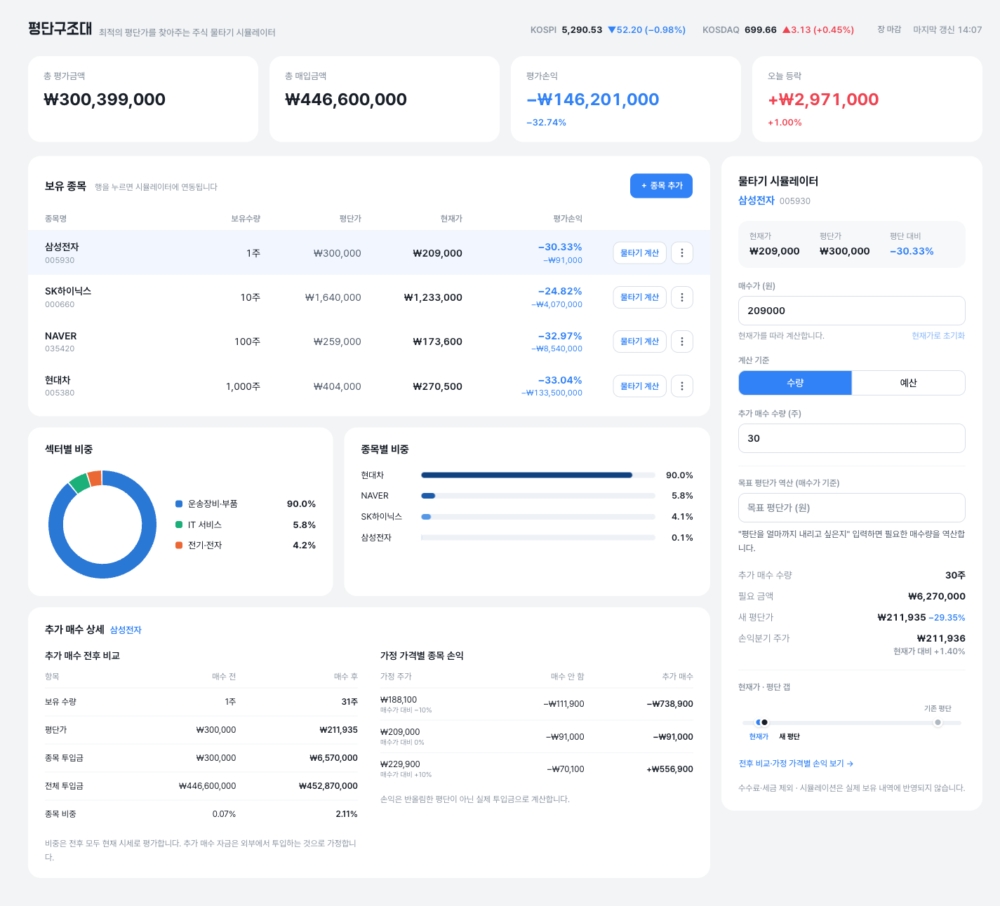
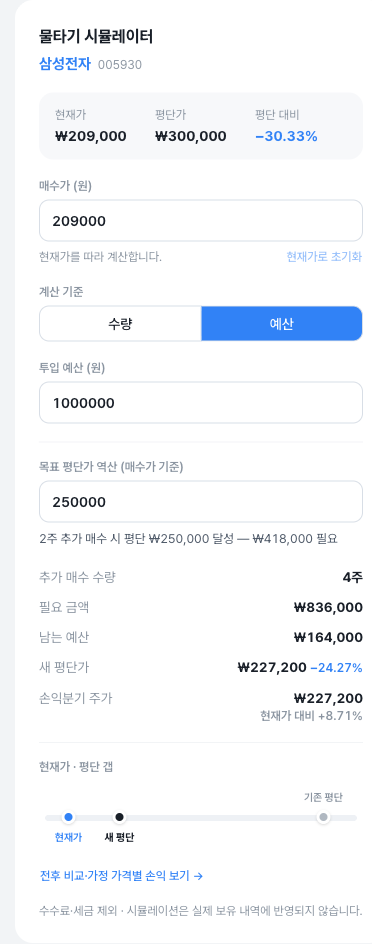
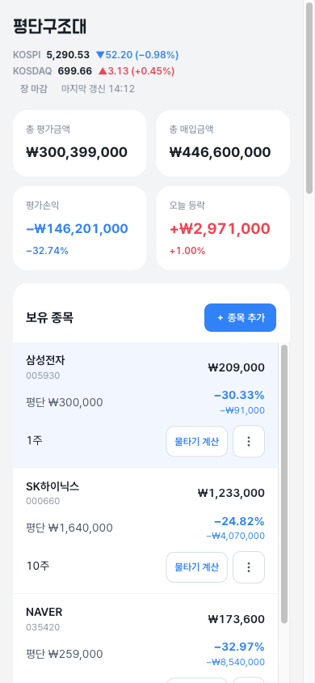

# 평단구조대

> **감으로 물타지 말고, 계산하고 물타세요.**
> 국내 주식 포트폴리오 트래커 + 물타기 시뮬레이터

**[데모 바로가기 → mool-ta-gi.vercel.app](https://mool-ta-gi.vercel.app)**

"물타기"는 보유 종목의 주가가 내려갔을 때 추가로 매수해 평균 단가를 낮추는 투자 은어입니다
(영어로는 Averaging Down). 저장소 이름 `mool-ta-gi`는 이 말에서 따왔고, 서비스 이름은
"물린 평단을 구조한다"는 뜻으로 **평단구조대**라고 지었습니다.



## 왜 만들었나

증권사 앱은 지금의 평단과 손익은 보여주지만 **"몇 주를 더 사면 평단이 얼마가 되는지"** 는
알려주지 않습니다. 그래서 물타기는 대개 계산기를 두드리거나 감으로 결정합니다.
결국 이런 질문에 즉시 답하지 못합니다.

- 100만 원으로 몇 주를 살 수 있고, 평단은 얼마가 되나?
- 평단을 25만 원까지 내리려면 몇 주가 필요한가?
- 추가 매수 후 이 종목이 포트폴리오에서 차지하는 비중은?
- 주가가 10% 더 빠지면, 물탄 쪽과 안 탄 쪽 중 어느 쪽 손실이 더 큰가?

평단구조대는 보유 종목과 실시간 시세를 한 화면에 두고, 이 질문들을 입력 즉시 계산합니다.

## 주요 기능

### 물타기 시뮬레이터

- **수량** 또는 **예산** 기준으로 추가 매수를 계산합니다. 예산 모드는 살 수 있는 주식 수와 남는 예산까지 보여줍니다.
- 매수가는 현재 시세를 따라가고, 직접 입력하면 가정 가격으로 고정됩니다.
- 새 평단가와 변화율, 손익분기 주가, 현재가·평단 갭 게이지를 보여줍니다.
- **목표 평단가 역산**으로 원하는 평단까지 필요한 수량과 금액을 계산합니다.
- **추가 매수 상세** 카드
  - 매수 전후의 평단·투입금·종목 비중을 비교합니다.
  - 매수가 기준 −10%·0%·+10% 주가에서 물탔을 때와 안 탔을 때의 손익을 비교합니다.

### 포트폴리오

- 요약 카드: 총 평가금액, 총 매입금액, 평가손익, 오늘 등락
- 보유 종목 테이블. 행을 누르면 그 종목이 시뮬레이터에 연동됩니다.
- 섹터별 비중(KRX 업종 기준) 도넛 차트와 종목별 비중 막대 차트
- 종목명·종목코드 검색으로 종목 추가. 업종은 자동으로 채워집니다.
- KOSPI·KOSDAQ 지수. 장중에는 30초마다 시세를 자동 갱신합니다.
- 보유 내역은 브라우저(localStorage)에 저장됩니다. 로그인이 필요 없습니다.



모바일에서는 보유 종목 → 시뮬레이터 → 추가 매수 상세 → 차트 순서로 쌓입니다.



## 기술 스택

Next.js 16 (App Router) · TypeScript · TanStack Query v5 · Zustand · Shadcn UI · Tailwind CSS ·
recharts · react-hook-form + zod · Vitest + RTL + MSW · ESLint (`eslint-plugin-boundaries`) ·
한국투자증권 OpenAPI

## 핵심 설계 결정

### 1. 상태를 두 갈래로 나눈다

이 앱의 데이터는 성격이 다른 두 종류이고, 저장하는 곳도 다릅니다.

|                     | 무엇                             | 어디에                 | 수명             |
| ------------------- | -------------------------------- | ---------------------- | ---------------- |
| **클라이언트 상태** | 보유 종목 (종목코드·수량·평단가) | Zustand + localStorage | 내가 팔기 전까지 |
| **서버 상태**       | 시세 (현재가·전일종가·등락)      | TanStack Query         | 몇 초면 낡는다   |

그래서 `Holding` 타입에는 현재가가 없습니다. 평가금액·손익·비중은 둘을 조합해 **매번
계산**하고, 저장하지 않습니다.

이 분리는 화면에도 그대로 드러납니다. 종목명·수량·평단가는 localStorage에서 오므로 바로
보이고, 시세에 기대는 칸만 스켈레톤으로 가립니다. 시세 조회가 실패해도 보유 내역은 그대로
남습니다.

### 2. 실패했을 때 목데이터로 채우지 않는다

잘못된 시세는 없는 시세보다 나쁩니다. 사용자가 그 숫자를 믿고 실제로 매매할 수 있기
때문입니다. 시세가 없으면 "—"와 다시 시도 버튼을 보여줍니다. 일부 종목만 실패하면 합계에서
뺐다는 사실을 화면에 밝힙니다.

시뮬레이터는 시세가 없어도 막히지 않습니다. 매수가를 직접 입력하면 원금·평단·손익은 시세
없이도 계산되기 때문입니다.

### 3. 시세는 BFF를 거친다

```text
브라우저 ──> /api/quotes   ──┐
        ├──> /api/indices  ──┴──> 한국투자증권 OpenAPI
        └──> /api/stocks   ────> 종목 마스터 (배포에 포함된 JSON)
             (Next.js Route Handler)
```

- **API 키 보호**: 브라우저는 KIS를 직접 부르지 않습니다. API 키가 클라이언트 번들에 들어가면
  안 되기 때문입니다. `src/shared/api/kis/`는 전부 `import 'server-only'`로 시작해서,
  클라이언트 코드가 실수로 import하면 빌드가 실패합니다.
- **에러 정규화**: KIS 원문 에러는 응답에 내보내지 않고 서버 로그에만 남깁니다. 사용자에게는
  정리된 문구만 보냅니다.
- **시세와 지수 분리**: 시세 쿼리 키에는 보유 종목코드가 들어갑니다. 지수를 같은 요청에 합치면
  종목을 추가하거나 삭제할 때마다 지수까지 다시 불립니다. 지수는 보유 종목과 무관하니 캐시
  키가 상수여야 합니다.
- **종목 검색은 KIS를 부르지 않습니다**: KIS에는 종목명 검색 API가 없습니다. 대신 KIS가 매일
  배포하는 종목 마스터 파일(3,500여 종목, KRX 업종 포함)을 `pnpm stocks:update`로 JSON으로
  변환해 함께 배포합니다. 그래서 검색은 유량 제한과 무관합니다.

### 4. 유량 제한은 문서가 아니라 실측으로 맞췄다

KIS 공식 샘플은 초당 20건을 시사하지만, 실측해 보니 **초당 약 1건**이었습니다.

- 단건 조회 대신 30종목을 한 번에 받는 배치 API를 씁니다.
- KIS로 나가는 모든 요청은 `rate-limit.ts`의 **전역 게이트**를 지납니다. 호출부마다 sleep을
  넣는 방식으로는 부족합니다. 서버는 요청마다 핸들러가 따로 돌기 때문에, 사용자가 둘이기만
  해도 서로의 간격을 모른 채 KIS를 호출합니다.
- 폴링은 장중(평일 09:00~15:30 KST)에만 30초 간격으로 돕니다. 429 응답에는 재시도하지
  않습니다.

토큰 캐시의 한계, 토큰 만료 실측, 전일 종가를 기준가로 쓰는 이유 같은 KIS 연동의 세부 사항은
[`src/shared/api/kis/README.md`](src/shared/api/kis/README.md)에 정리했습니다.

## 물타기 계산

계산은 전부 `entities/holding`의 순수 함수입니다(`calcSimulation`, `calcQuantityForTargetAverage`).
UI와 분리돼 있어 단위 테스트로 검증합니다.

```text
새 평단 = (보유수량 × 평단 + 추가수량 × 매수가) / (보유수량 + 추가수량)

예산 모드 추가수량 = floor(예산 / 매수가)        남는 예산 = 예산 − 추가수량 × 매수가

목표 평단 역산 수량 = ceil(보유수량 × (평단 − 목표) / (목표 − 매수가))
```

| 규칙                         | 이유                                                                             |
| ---------------------------- | -------------------------------------------------------------------------------- |
| 추가 매수는 정수 주 단위     | 실제 주문과 같게 맞춘다                                                          |
| 손익분기 주가는 원 단위 올림 | 반올림하면 1원 모자란 가격을 본전이라고 안내하게 된다                            |
| 손익은 실제 투입금으로 계산  | 평단은 원 단위로 표시하지만, 반올림한 평단으로 손익을 내면 1원씩 어긋난다        |
| 목표 평단은 매수가보다 높게  | 매수가보다 낮은 평단은 아무리 사도 만들 수 없다. 범위를 벗어나면 이유를 안내한다 |
| 비중은 전후 모두 현재가 평가 | 매수가는 가정일 수 있지만, 비중 비교는 같은 시세로 해야 공정하다                 |
| 추가 자금은 외부에서 투입    | 다른 종목을 팔아 마련하지 않는다고 가정한다                                      |
| 수수료·세금 제외             | 증권사마다 달라 일반화할 수 없다                                                 |

시뮬레이션은 보유 내역을 바꾸지 않습니다. 다른 종목을 고르면 입력이 초기화됩니다.

## 아키텍처

FSD(Feature-Sliced Design)를 5레이어로 줄여 씁니다. `app/`은 라우팅만 하는 얇은 껍데기이고,
실제 코드는 모두 `src/`에 있습니다.

```text
app → views → widgets → features → entities → shared
```

- **역방향 import 금지**: 아래 레이어는 위 레이어를 모릅니다.
- **같은 레이어 슬라이스끼리 import 금지**: 공유가 필요하면 공통 부분을 아래 레이어로 내립니다.
- **public API**: 각 슬라이스는 `index.ts`로만 노출합니다.
- 이 규칙은 `eslint-plugin-boundaries`가 `pnpm lint`에서 검사합니다. 규칙을 어기면 린트가 실패합니다.

| 레이어     | 슬라이스                                                                                                                              |
| ---------- | ------------------------------------------------------------------------------------------------------------------------------------- |
| `views`    | `dashboard`: 위젯 배치 (데스크톱 2열, 모바일 1열)                                                                                     |
| `widgets`  | `portfolio-summary` `holdings-table` `averaging-panel` `simulation-detail` `sector-chart` `holding-allocation` `market-header`        |
| `features` | `simulate-averaging`(시뮬레이터 입력 상태), `holding-quotes`(보유 종목 × 시세), `add-holding`, `edit-holding`, `sync-holding-sectors` |
| `entities` | `holding`(보유 종목, 파생 계산, 시뮬레이션), `quote`(시세), `market-index`(지수)                                                      |
| `shared`   | `api/kis`(KIS 어댑터, 서버 전용), API 계약·폴링 정책, 종목 마스터, UI 컴포넌트                                                        |

구조가 실제 결정에 영향을 준 예 두 가지입니다.

- **두 엔티티는 서로를 import하지 않습니다.** `entities/holding`은 `PriceSnapshot { current, prevClose }`라는
  구조적 타입만 선언하고, `entities/quote`의 `Quote`가 그 형태를 만족합니다. 둘을 조합하는 곳은
  `features/holding-quotes` 한 곳뿐입니다. 여러 위젯이 각자 `useHoldingQuotes()`를 불러도,
  정렬·중복 제거한 종목코드 배열이 쿼리 키라서 네트워크 요청은 1건으로 합쳐집니다.
- **시뮬레이터 입력은 feature 스토어에 둡니다.** 시뮬레이터 패널과 추가 매수 상세 카드는 같은
  widgets 레이어라 서로 import할 수 없습니다. 그래서 두 위젯이 같은 입력을 보도록 입력값을
  `features/simulate-averaging`으로 내렸습니다. 이 스토어는 영속화하지 않습니다.

## 시작하기

```bash
pnpm install
cp .env.example .env.local   # KIS 앱키·시크릿을 채운다
pnpm dev                     # http://localhost:3000
```

`.env.local`이 없어도 앱은 뜹니다. 시세만 "불러오지 못했습니다"로 표시됩니다.
KIS 키는 [한국투자증권 API 포털](https://apiportal.koreainvestment.com/)에서 발급받을 수 있습니다.

```bash
pnpm build             # 프로덕션 빌드
pnpm lint              # ESLint (FSD 경계 검사 포함)
pnpm test              # Vitest
pnpm exec tsc --noEmit # 타입 체크
pnpm stocks:update     # 종목 마스터(종목명·코드·KRX 업종) 갱신
```

## 테스트

Vitest + React Testing Library로 22개 파일, 196개 테스트를 둡니다(2026-11 기준).

- **계산**: 평단·손익·비중·시뮬레이션·목표 평단 역산의 경계값. 0주, 안전한 정수 범위 초과, 도달할 수 없는 목표가를 포함합니다.
- **BFF 계약**: 쿼리 파라미터 파싱, KIS 응답 매핑, 전역 간격 제어
- **위젯**: 사용자 입력에 따른 결과, 로딩·빈 상태·시세 실패 화면

MSW로 BFF 라우트를 가로채고 `onUnhandledRequest: 'error'`를 켜 둡니다. 그래서 테스트가 실제
네트워크를 호출하면 바로 실패합니다. 새 엔드포인트를 추가할 때는 기본 핸들러도 함께 등록해야
합니다(`src/shared/testing/msw-server.ts`).

## AI와 함께 개발한 방식

이 프로젝트는 AI 두 개에 역할을 나눠 맡겨 만들었습니다. **Claude Code가 코드를 작성하고,
Codex가 그 코드를 따로 검증합니다.** 작성한 쪽이 자기 코드를 검토하면 같은 맹점을 공유하기
쉬워서, 검토를 다른 모델에 맡겼습니다.

AI에게 코드를 통째로 맡기지 않고, AI가 벗어날 수 없는 틀을 먼저 만들었습니다.

- **규칙을 문서로 고정**: `CLAUDE.md`에 레이어 구조, 네이밍, 커밋 규칙, "완료 보고 전 lint·build
  통과"를 적어 두었습니다. Codex가 읽는 `AGENTS.md`는 규칙을 복사하지 않고 `CLAUDE.md`를 가리키며,
  검토할 때 확인할 항목을 덧붙입니다. 그래서 두 AI가 같은 규칙으로 작성하고 검증합니다.
- **규칙을 도구로 강제**: FSD 의존 방향은 `eslint-plugin-boundaries`, 타입은 `strict` TypeScript,
  동작은 테스트가 검사합니다. AI가 만든 코드도 이 관문을 통과해야 합니다.
- **화면은 직접 띄워서 확인**: UI를 바꾸면 Playwright로 데스크톱·모바일 화면을 띄워 확인했습니다.
  모바일 요약 카드에서 큰 금액이 넘치는 문제도 이 과정에서 찾았습니다.
- **판단은 사람이**: 상태 분리, 목데이터 금지, 유량 제한 대응 같은 설계 결정과 화면 구성은 직접
  정했습니다. 두 AI의 제안과 지적은 근거를 따져 채택하거나 버렸습니다.

## 한계와 다음 단계

- **공휴일 휴장 미반영**: `isMarketOpen`은 평일 09:00~15:30만 봅니다. 설·추석에도 장중으로 판정해 폴링합니다.
- **토큰·간격 제어가 인스턴스 로컬**: 서버리스 인스턴스가 여러 개 뜨면 각자 토큰을 발급하고 간격을 따로 셉니다.
  KIS가 6시간 안의 재요청에는 같은 토큰을 돌려주므로 지금은 감수하고 있습니다. `getAccessToken()`의 시그니처는
  그대로 두고 내부만 Upstash Redis나 Vercel KV로 바꾸면 되도록 설계했습니다.
- **기기 간 동기화 없음**: 보유 내역은 브라우저에만 저장됩니다.
- **종목 마스터 수동 갱신**: 신규 상장이나 상호 변경은 `pnpm stocks:update`를 다시 돌려 배포해야 반영됩니다.
